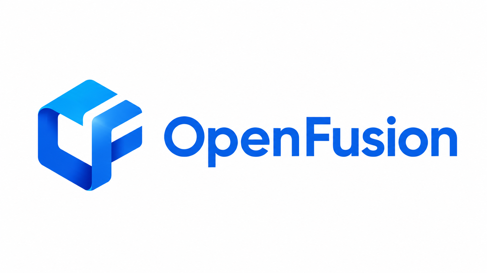

<div align="center">
  

[](#installation)
[](#installation)
[](#installation)
[](#installation)
[](#installation)
[](#installation)
[](#model-zoo)
[](#whats-new)

[Documentation](#documentation) |
[Installation](#installation) |
[Model Zoo](#model-zoo) |
[Update News](#whats-new) |
[Project Progress](#project-progress) |
[Reporting Issues](#reporting-issues)

</div>

## Introduction

OpenFusion is an operator-oriented research codebase for multimodal 3D object detection. It decomposes camera, LiDAR, radar, BEV, frustum, feature-level fusion, data-level fusion, and decision-level fusion pipelines into reusable PyTorch operators and composable neural blocks.

Instead of treating each published fusion model as an isolated repository, OpenFusion rebuilds representative multimodal methods on top of a shared operator library. Users can inspect the fusion path, replace individual operators, assemble new models, and train reconstructed networks on KITTI with standard 2D/3D perception backbones.

The current public model release focuses on four trained networks under `model/`: **BEVFusion**, **CLOCs**, **HMFI**, and **LoGoNet**.

For the Ascend implementation corresponding to this repository, please see: [Ascend Version]().

<details open>
<summary>Major features</summary>

- **Operatorized Fusion Design**

  Fusion logic is decomposed into callable operators under `fusion_unit/`, `common/`, and `utils/`. Geometry projection, feature sampling, BEV alignment, attention fusion, IoU assignment, NMS, pair encoding, voxel grouping, and frustum construction can be reused across models.

- **Composable Model Reconstruction**

  Every reconstructed model is organized as a framework, an initialization builder, and model-specific modules. This makes it straightforward to swap a fusion operator, change a backbone adapter, or rebuild a paper pipeline from smaller units.

- **Multi-Level Multimodal Fusion**

  OpenFusion covers data-level, feature-level, and decision-level fusion, with both symmetric and asymmetric fusion patterns. The codebase is designed for camera-LiDAR, camera-radar, BEV, point, voxel, proposal, and detector-score fusion.

- **Training-Ready Reference Networks**

  Released models include train/test entry scripts, KITTI data loading logic, checkpoint configuration, and KITTI-format prediction export. The reconstructed fusion modules can be trained while freezing or fine-tuning external 2D/3D perception backbones.

</details>

## Documentation

The README is the primary documentation entry for the current release. It includes the repository architecture, released model zoo, validated environment, KITTI dataset preparation, operator-based model reconstruction workflow, training commands, testing commands, and project progress.

For implementation details, start from the corresponding model directory under `model/`, then follow its framework, initialization builder, and module files. Reusable operators are organized under `fusion_unit/`, `common/`, and `utils/`.

## What's New

**2026-07-08**: OpenFusion is organized as a GitHub repository with an operatorized multimodal fusion library and four released trained model directories: **BEVFusion**, **CLOCs**, **HMFI**, and **LoGoNet**.

**2026-06-26**: Released trained model checkpoints and reconstruction pipelines for **CLOCs**, **HMFI**, and **LoGoNet**.

**2026-06-21**: Completed the **BEVFusion** reconstruction with camera-view transformation, LiDAR BEV generation, BEV fusion, and detection task modules.

## Architecture

```text
OpenFusion/
├── backbone/                 # Adapters for image, point cloud, BEV, 2D detector, and 3D detector backbones
├── common/                   # Shared neural components: heads, encoders, attention, pooling, RoI, voxel, and FFN blocks
├── fusion_unit/              # Reusable fusion operators and learnable fusion blocks
│   ├── asymmetric/           # One modality drives the fusion and auxiliary modalities provide evidence
│   │   ├── data/             # Asymmetric data-level fusion
│   │   ├── feature/          # Asymmetric feature-level fusion
│   │   └── decision/         # Asymmetric decision-level fusion
│   └── symmetric/            # Balanced or bidirectional multimodal fusion
│       ├── data/             # Symmetric data-level fusion
│       ├── feature/          # Symmetric feature-level fusion
│       └── decision/         # Symmetric decision-level fusion
├── model/                    # Reconstructed multimodal 3D detection networks
│   ├── bevfusion/            # Camera-LiDAR BEV fusion pipeline
│   ├── clocs/                # 2D-3D detection score fusion pipeline
│   ├── hmfi/                 # Hierarchical multimodal feature interaction pipeline
│   └── logonet/              # Local-global multimodal fusion pipeline
└── utils/                    # Geometry, projection, voxelization, sampling, IoU, NMS, and KITTI utilities
```

## Model Zoo

### KITTI 3D Object Detection Results: Car

| Method | Modality | Ours 3D AP (Easy/Mod./Hard) | Ours BEV AP (Easy/Mod./Hard) | Paper 3D AP (Easy/Mod./Hard) | Paper BEV AP (Easy/Mod./Hard) | Pretrained Weights |
| --- | --- | --- | --- | --- | --- | --- |
| CLOCs | LiDAR + Camera | **89.35 / 85.39 / 80.28** | **95.55 / 89.94 / 84.50** | 88.94 / 80.67 / 77.15 | 93.05 / 89.80 / 86.57 | [Download](https://drive.google.com/file/d/1Bqo5Q7DqQFM9B9myeS4m-iMzfPVWkwce/view?usp=drive_link) |
| LoGoNet | LiDAR + Camera | 87.39 / 78.36 / 75.04 | **91.08 / 85.00 / 83.80** | 91.80 / 85.06 / 80.74 | - | [Download](https://drive.google.com/file/d/1W0yIp6YS6x9yD9g83YjJumCSLX6u0Soa/view?usp=drive_link) |
| HMFI | LiDAR + Camera | **91.73 / 80.41 / 75.44** | **95.62 / 89.73 / 84.84** | 88.90 / 81.93 / 77.30 | - | [Download](https://drive.google.com/file/d/14n1WIC8r6CXTeoQWlzODQvXMEt27uD4s/view?usp=drive_link) |
| BEVFusion | LiDAR + Camera | Available in repository evaluation outputs | Available in repository evaluation outputs | - | - | Local release |

## Installation

This section follows the same installation style as the OpenMMLab toolboxes: create an isolated conda environment, install PyTorch first, install OpenMMLab dependencies with MIM, then install the remaining 3D perception dependencies and verify the repository.

### Prerequisites

OpenFusion is developed and tested on Linux with NVIDIA GPUs. A CPU-only environment can import part of the operator library, but training and evaluating the released 3D detection models require CUDA-enabled PyTorch and GPU-compatible MMDetection3D / OpenPCDet dependencies.

The validated environment is:

| Item | Version |
| --- | --- |
| Python | 3.8.20 |
| PyTorch | 1.13.1+cu117 |
| torchvision | 0.14.1+cu117 |
| CUDA used by PyTorch | 11.7 |
| NVIDIA Driver | 535.247.01 |
| Server CUDA capability | 12.2 |
| GPU | Tesla V100-SXM2-32GB x 2 |
| MMCV | 2.1.0 |
| MMDetection | 3.3.0 |
| MMDetection3D | 1.4.0 |
| MMEngine | 0.10.7 |
| OpenPCDet | 0.6.0 |

The reported CUDA version in `nvidia-smi` is the maximum CUDA version supported by the driver. The runtime version used by this project is the CUDA version compiled into PyTorch, namely `torch.version.cuda == 11.7` in the validated setup.

### Step 1. Create a Conda Environment

Install Miniconda or Anaconda first, then create a clean Python 3.8 environment:

```bash
conda create -n fusionrepo python=3.8 -y
conda activate fusionrepo
```

### Step 2. Install PyTorch

Install PyTorch before installing OpenMMLab packages, because MMCV and MMDetection3D select binary extensions according to the PyTorch and CUDA versions.

```bash
conda install pytorch==1.13.1 torchvision==0.14.1 pytorch-cuda=11.7 -c pytorch -c nvidia -y
```

Verify PyTorch and CUDA:

```bash
python --version
python -c "import torch; print(torch.__version__, torch.version.cuda)"
python -c "import torch; print('cuda available:', torch.cuda.is_available())"
nvidia-smi
```

### Step 3. Install OpenMMLab Dependencies

Install MIM first, then install MMEngine, MMCV, MMDetection, and MMDetection3D. MIM is recommended because it resolves many binary compatibility details for OpenMMLab packages.

```bash
pip install -U openmim
mim install mmengine==0.10.7
mim install mmcv==2.1.0
mim install mmdet==3.3.0
mim install mmdet3d==1.4.0
```

If your platform cannot resolve `mmcv==2.1.0` automatically, install the wheel that matches PyTorch 1.13 and CUDA 11.7:

```bash
pip install mmcv==2.1.0 -f https://download.openmmlab.com/mmcv/dist/cu117/torch1.13/index.html
```

### Step 4. Install General Python Dependencies

Install the scientific and vision packages used by the data loading, geometry, visualization, and evaluation utilities:

```bash
pip install numpy==1.23.5 scipy==1.10.1 opencv-python open3d pillow tqdm matplotlib pyyaml tensorboard
```

### Step 5. Install OpenPCDet

Some reconstructed models use OpenPCDet-style point cloud backbones or checkpoint formats. Install OpenPCDet in editable mode so its local modules can be imported by the training and testing scripts:

```bash
git clone https://github.com/open-mmlab/OpenPCDet.git
cd OpenPCDet
git checkout v0.6.0
pip install -r requirements.txt
python setup.py develop
cd ..
```

If you already maintain a local OpenPCDet checkout, install that copy instead and make sure `import pcdet` works in the `fusionrepo` environment.

### Step 6. Clone OpenFusion and Set PYTHONPATH

Clone this repository and enter the project root:

```bash
git clone https://github.com/MSFTest/OpenFusion.git
cd OpenFusion
```

For source-tree execution, expose the repository root to Python:

```bash
export PYTHONPATH="$(pwd):$PYTHONPATH"
```

You can also add the line above to `~/.bashrc` or your conda activation script if you use OpenFusion frequently.

### Step 7. Prepare Checkpoints

Place the required 2D detector, 3D detector, and fusion checkpoints under `checkpoints/`. The current scripts use paths such as:

```text
checkpoints/faster_rcnn_r50_caffe_fpn_mstrain_1x_coco-5324cff8.pth
checkpoints/hv_PartA2_secfpn_2x8_cyclic_80e_kitti-3d-car_20210831_022017-cb7ff621.pth
checkpoints/pv_rcnn_8xb2-80e_kitti-3d-3class_20221117_234428-b384d22f.pth
checkpoints/hmfi_fusion_trained.pth
checkpoints/logonet_fusion_trained.pth
checkpoints/clocs_fusion_trained.pth
```

The released fusion checkpoints are listed in the [Model Zoo](#model-zoo). Backbone checkpoints can be downloaded from the corresponding MMDetection, MMDetection3D, or OpenPCDet model releases.

### Step 8. Verify the Installation

Run the following checks from the OpenFusion root:

```bash
python -c "import torch; print('torch:', torch.__version__, 'cuda:', torch.version.cuda, 'available:', torch.cuda.is_available())"
python -c "import mmcv, mmdet, mmdet3d, mmengine; print('mmcv:', mmcv.__version__); print('mmdet:', mmdet.__version__); print('mmdet3d:', mmdet3d.__version__); print('mmengine:', mmengine.__version__)"
python -c "import pcdet; print('pcdet imported')"
python -c "import utils, common, fusion_unit; import torch; x=torch.ones(2,3); y=torch.ops.fusionrepo.feature_fusion_weighted_sum(torch.stack([x,x]), torch.tensor([0.5,0.5])); print(y.shape, y.sum().item())"
```

Expected output:

```text
torch: 1.13.1+cu117 cuda: 11.7 available: True
mmcv: 2.1.0
mmdet: 3.3.0
mmdet3d: 1.4.0
mmengine: 0.10.7
pcdet imported
torch.Size([2, 3]) 6.0
```

### Troubleshooting

- If `torch.cuda.is_available()` is `False`, check the NVIDIA driver, conda environment, and whether the installed PyTorch build is CUDA-enabled.
- If MMCV fails to import CUDA extensions, reinstall MMCV with a wheel matching your PyTorch and CUDA versions.
- If `mmdet3d` cannot import custom ops, reinstall MMDetection3D after PyTorch and MMCV are already installed.
- If `pcdet` cannot be imported, confirm that OpenPCDet was installed with `python setup.py develop` inside the active `fusionrepo` environment.
- If OpenFusion operators are missing from `torch.ops.fusionrepo`, make sure `utils`, `common`, and `fusion_unit` are imported before calling the operator namespace.

## Dataset Preparation

OpenFusion uses the KITTI object detection format. The dataset can be placed outside the repository as long as the standard structure is preserved:

```text
/path/to/KITTI/
└── training/
    ├── image_2/
    ├── velodyne/
    ├── calib/
    └── label_2/
```

Pass the dataset root to train/test scripts with:

```bash
--kitti_root /path/to/KITTI
```

Optional split files can be provided through `--split_file` or `--train_split_file` when supported by the selected model entry script.

## Rebuilding Models with OpenFusion Operators

OpenFusion operators are registered as a PyTorch namespace named `fusionrepo`. Importing `utils`, `common`, and `fusion_unit` activates the operator definitions and implementations:

```python
import torch
import utils        # registers geometry, projection, IoU, NMS, and utility ops
import common       # registers shared neural components
import fusion_unit  # registers fusion-unit operators and blocks

features = torch.randn(2, 128, 64)
weights = torch.tensor([0.6, 0.4])
fused = torch.ops.fusionrepo.feature_fusion_weighted_sum(features, weights)
```

A reconstructed model usually follows this pattern:

1. Define external perception adapters in `backbone/`, such as an MMDetection image extractor or an MMDetection3D point-cloud detector.
2. Select fusion operators from `fusion_unit/`, `common/`, and `utils/`.
3. Assemble the model-level forward path in `model/{method}/{method}_framework.py`.
4. Build checkpoints, losses, optimizers, freeze policies, and post-processing in `model/{method}/initialization/build_{method}_system.py`.
5. Expose a train/test CLI in `model/{method}/test_{method}.py` or `model/{method}/test_script.py`.

For example, HMFI uses the shared operator stack to lift image features into voxel space, align them with LiDAR tokens, run query-based feature fusion, and train a detection head:

```text
model/hmfi/
├── hmfi_framework.py
├── initialization/build_hmfi_system.py
├── module/ivlm_module.py
├── module/qfm_module.py
├── module/vfim_module.py
└── test_hmfi.py
```

This layout lets users replace a single operator, such as `feature_sampling_by_grid`, `compute_voxel_centroid`, `multihead_attention_fusion`, `nms3d`, or `feature_fusion_weighted_sum`, without rewriting the whole detection system.

## Training

Use the selected model entry script and provide KITTI, backbone checkpoints, and the fusion checkpoint output path. HMFI is shown below:

```bash
python model/hmfi/test_hmfi.py \
  --mode train \
  --kitti_root /path/to/KITTI \
  --device cuda:0 \
  --epochs 80 \
  --batch_size 1 \
  --image_ckpt ./checkpoints/faster_rcnn_r50_caffe_fpn_mstrain_1x_coco-5324cff8.pth \
  --point_cloud_ckpt ./checkpoints/hv_PartA2_secfpn_2x8_cyclic_80e_kitti-3d-car_20210831_022017-cb7ff621.pth \
  --save_ckpt ./checkpoints/hmfi_fusion_trained.pth
```

LoGoNet follows the same train/test style:

```bash
python model/logonet/test_script.py \
  --mode train \
  --kitti_root /path/to/KITTI \
  --device cuda:0 \
  --epochs 80 \
  --batch_size 1 \
  --image_ckpt ./checkpoints/faster_rcnn_r50_caffe_fpn_mstrain_1x_coco-5324cff8.pth \
  --point_cloud_ckpt ./checkpoints/pv_rcnn_8xb2-80e_kitti-3d-3class_20221117_234428-b384d22f.pth \
  --save_ckpt ./checkpoints/logonet_fusion_trained.pth
```

CLOCs uses `eval` instead of `test` for evaluation mode:

```bash
python model/clocs/test_script.py \
  --mode train \
  --kitti_root /path/to/KITTI \
  --device cuda:0 \
  --epochs 80 \
  --fusion_ckpt ./checkpoints/clocs_fusion_trained.pth
```

## Testing

Run evaluation with a trained fusion checkpoint and export KITTI-format predictions:

```bash
python model/hmfi/test_hmfi.py \
  --mode test \
  --kitti_root /path/to/KITTI \
  --device cuda:0 \
  --image_ckpt ./checkpoints/faster_rcnn_r50_caffe_fpn_mstrain_1x_coco-5324cff8.pth \
  --point_cloud_ckpt ./checkpoints/hv_PartA2_secfpn_2x8_cyclic_80e_kitti-3d-car_20210831_022017-cb7ff621.pth \
  --fusion_ckpt ./checkpoints/hmfi_fusion_trained.pth \
  --pred_dir ./pred_kitti_hmfi
```

BEVFusion provides a native KITTI evaluation option:

```bash
python model/bevfusion/test_bevfusion.py \
  --mode test \
  --kitti_root /path/to/KITTI \
  --device cuda:0 \
  --fusion_ckpt ./checkpoints/bevfusion_fusion_last.pth \
  --pred_dir results/bevfusion_kitti/data \
  --evaluator native
```

Predictions are written in KITTI `label_2` style under the configured `--pred_dir`.

## Project Progress

Latest updates are listed first.

- [x] Reconstructed Faraway-Frustum fusion module [2026-07-08]
- [x] Released CLOCs, HMFI, and LoGoNet trained models [2026-06-26]
- [x] Reconstructed BEVFusion fusion module [2026-06-21]
- [x] Reconstructed EPNet++ fusion module [2026-06-15]
- [x] Reconstructed EPNet fusion module [2026-06-15]
- [x] Reconstructed PointPainting fusion module [2026-06-08]
- [x] Reconstructed CenterFusion fusion module [2026-06-01]
- [x] Reconstructed 3D-CVF fusion module [2026-05-25]
- [x] Reconstructed F-ConvNet fusion module [2026-05-18]
- [x] Reconstructed VirConv fusion module [2026-04-13]
- [x] Reconstructed MPCF fusion module [2026-04-06]
- [x] Reconstructed HMFI fusion module [2026-03-30]
- [x] Reconstructed LoGoNet fusion module [2026-03-23]
- [x] Reconstructed AVOD fusion module [2026-03-12]
- [x] Reconstructed CLOCs_LQS fusion module [2026-03-07]

## Acknowledgement

OpenFusion builds on the PyTorch ecosystem and uses MMDetection, MMDetection3D, MMEngine, MMCV, and OpenPCDet components for backbone initialization, feature extraction, 3D perception, and evaluation. We thank the authors of the original multimodal fusion papers and the open-source communities that make reproducible 3D perception research possible.

## Reporting Issues

If you encounter installation problems, missing checkpoints, dataset path errors, operator registration failures, or inconsistent KITTI evaluation results, please open an issue in the OpenFusion repository and include the model name, command line, environment versions, checkpoint paths, and the relevant error log.

## Citation

If OpenFusion helps your research, please cite this repository and the original papers corresponding to the reconstructed models you use.
